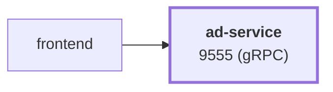

# ad-service

service · platform-demo

A gRPC service that serves contextual advertisements for the platform-demo e-commerce platform. It returns ads keyed by product category, falling back to random ads when no context is given or nothing matches. It is stateless, has no downstream dependencies, and is called only by `frontend`.

Runtime<strong>Java 21</strong><small>Java</small>

Listens on<strong>9555</strong><small>gRPC</small>

State<strong>Stateless</strong>

Image<strong>ad-service</strong><small>mladenovskistefan/</small>

## Where it sits

Called by `frontend`. It has no downstream dependencies.

## At a glance

| | |
|---|---|
| **Language / runtime** | Java 21 (Eclipse Temurin), Gradle, gRPC-Java |
| **Image** | `mladenovskistefan/ad-service` |
| **Protocol / port** | gRPC (HTTP/2, plaintext) on `9555` |
| **Metrics** | Pushed over OTLP/gRPC to Alloy → Mimir every 15 s (no scrape endpoint). Dashboard names: `rpc_server_duration_seconds_{bucket,count,sum}`, `rpc_server_requests_total`, `rpc_server_active_requests` |
| **Health** | Standard `grpc.health.v1.Health/Check` on `9555` (always `SERVING` once the server has started) |
| **State** | None. Ad catalog is hard-coded in `AdsMap.java` |
| **Depends on** | Nothing (optional: OTLP collector, Pyroscope) |
| **Called by** | `frontend` (with a 100 ms client-side deadline) |
| **gRPC reflection** | Not enabled — pass `-proto` to `grpcurl` |

## Find it elsewhere

<h4><a href="https://argocd.platform-demo.click/applications/argocd/dev-ad-service">Argo CD</a></h4>
Sync and health of <code>dev-ad-service</code>.

<h4><a href="https://github.com/platform-boutique/app-ad-service">Repository</a></h4>
Source, pull requests and releases of <code>app-ad-service</code>.

!!! info "Part of the platform-demo platform"
    Cross-cutting facts (service wiring, observability contract, Kubernetes translation, CI/CD) are in the
    [master reference](https://github.com/platform-boutique/platform-demo-docs). This site only describes ad-service.
